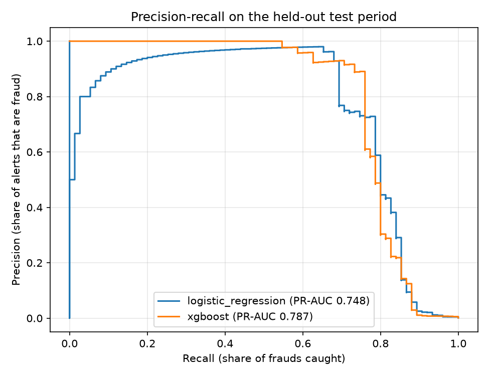
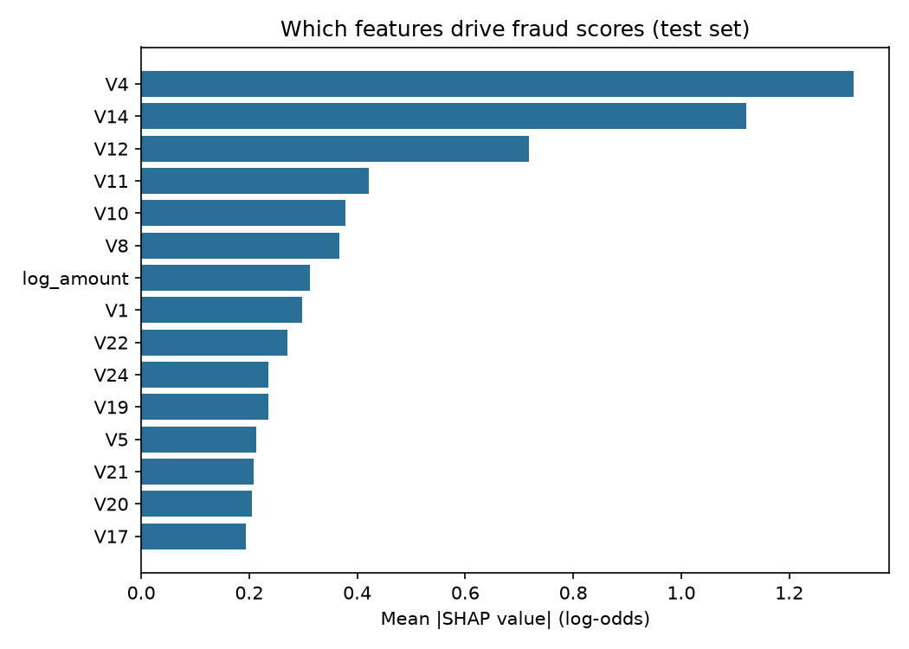

# Explainable Credit Card Fraud Detection


Detects fraudulent card transactions with XGBoost, explains every alert with SHAP values, and is evaluated the way a bank would deploy it: trained on past transactions, tested on later ones. Includes a model card and a Streamlit dashboard for fraud analysts.

## Results

Held-out test period: the latest 20% of transactions (56,962 transactions, 75 frauds), never used for training or tuning. The alert threshold for each model was chosen on the validation period.

| Model | PR-AUC | ROC-AUC | Precision | Recall | False alarms | Fraud value caught |
|---|---|---|---|---|---|---|
| Logistic regression (baseline) | 0.748 | 0.983 | 96.2% | 66.7% (50 / 75) | 2 | 60.3% |
| **XGBoost** | **0.787** | 0.981 | 88.9% | **74.7% (56 / 75)** | 7 | **65.9%** |

In plain terms: out of almost 57,000 transactions, XGBoost raised 63 alerts, 56 of which were real fraud, and stopped two thirds of the money that would have been lost. It scores one transaction in about 15 ms.



## Why these choices

- **Accuracy is not used.** Only 0.17% of transactions are fraud, so a model that never flags anything is 99.8% "accurate". PR-AUC, precision, recall and fraud value caught are what a fraud team cares about.
- **Time-based split.** A random split lets the model learn from transactions that happen after the ones it is tested on. Here it trains on the first 60% of the timeline, tunes on the next 20% and is tested on the last 20%.
- **Class weighting chosen on validation only.** Up-weighting frauds by the square root of the class ratio beat both no weighting and the full ratio on validation PR-AUC (0.786 vs 0.774 and 0.775, see [`scripts/tune_class_weight.py`](scripts/tune_class_weight.py)). The test period was not used to pick it.
- **Threshold on validation.** The alert threshold maximises F1 on the validation period. The dashboard lets an analyst move it and see the trade-off between missed fraud and review workload.

## Explainability and responsible AI

Every score can be broken down into SHAP values (exact TreeSHAP, computed by XGBoost itself): how much each feature pushed this transaction towards or away from fraud.



The [model card](MODEL_CARD.md) records intended use, data, metrics, limitations and a slice check by transaction amount. That check found recall is weaker on transactions over 500 (2 of 4 frauds caught), which is exactly the kind of gap a reviewer needs to see before deployment.

## Run it

```bash
pip install -r requirements.txt
python scripts/download_data.py      # 150 MB public dataset
python -m fraud.train                # trains both models, writes reports/ and models/
streamlit run app/streamlit_app.py   # analyst dashboard
pytest                               # tests use synthetic data, no download needed
```

Training both models takes under a minute on a laptop CPU (35 seconds in the run reported here).

## Project layout

```
fraud/data.py        loading, validation, features, time-based split
fraud/train.py       baseline + XGBoost, threshold selection, reports
fraud/metrics.py     PR-AUC, precision/recall, fraud value caught, amount slices
fraud/explain.py     SHAP values and top reasons per transaction
app/                 Streamlit dashboard for fraud analysts
scripts/             data download, class-weight tuning
reports/             measured metrics and figures
tests/               unit tests and an end-to-end run on synthetic data
```

## Data

[Credit Card Fraud Detection dataset](https://www.kaggle.com/datasets/mlg-ulb/creditcardfraud) from the Machine Learning Group of Université Libre de Bruxelles and Worldline: 284,807 European card transactions over two days in September 2013, 492 of them fraud. Features V1-V28 are PCA components released in anonymised form, so explanations name components rather than raw fields such as merchant or location.

## License

MIT
